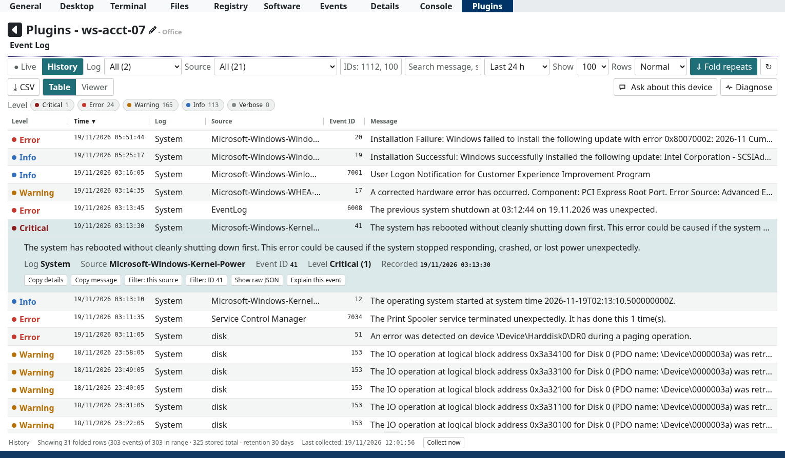
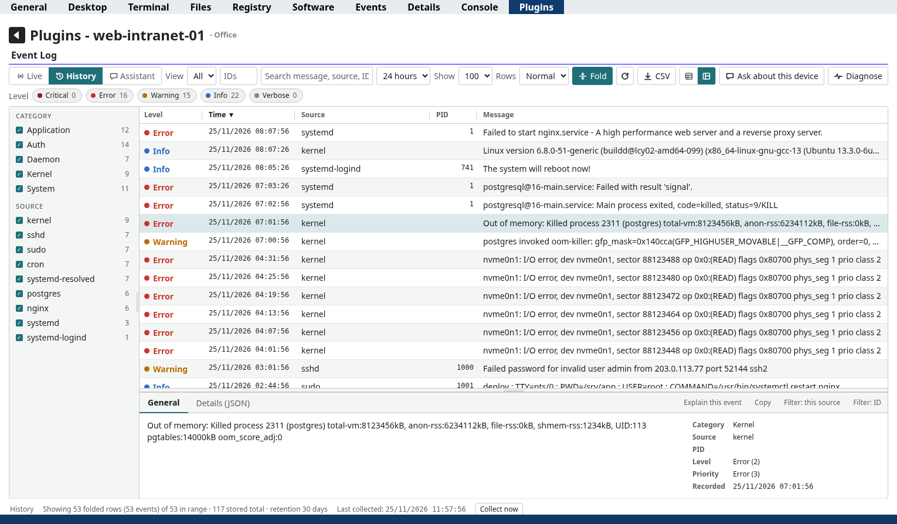
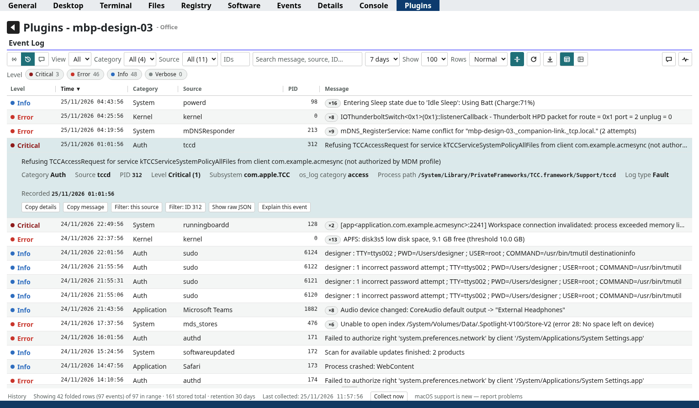
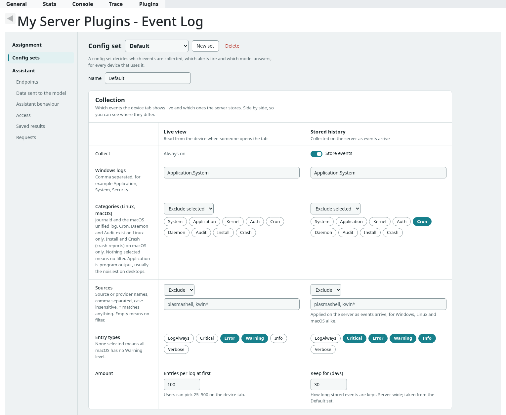
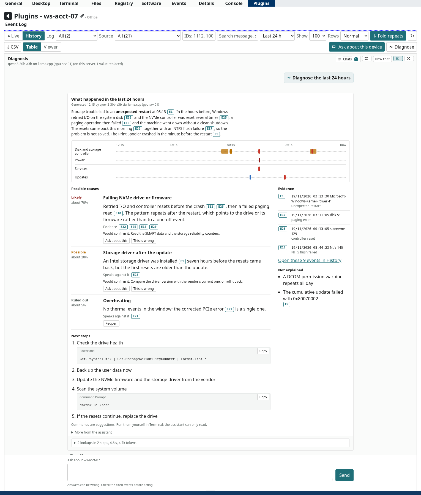
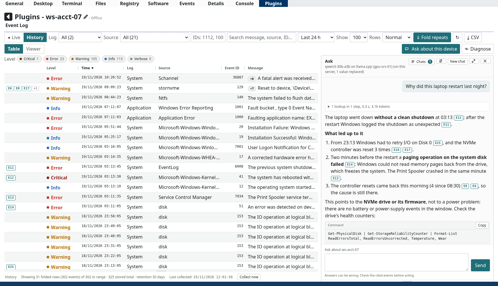
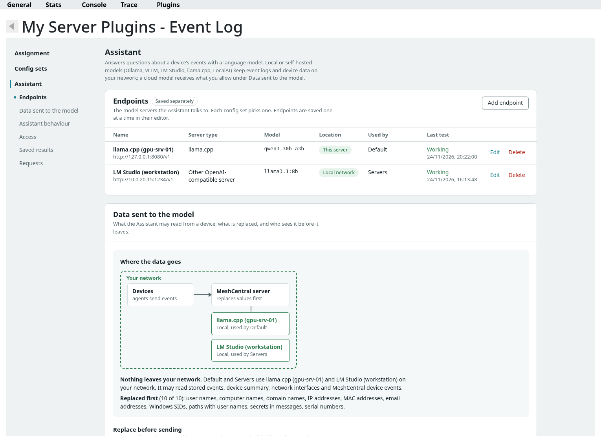

# MeshCentral-EventLog

*Current Version: 0.8.0
Released: 2026-11-24*

A [MeshCentral](https://github.com/Ylianst/MeshCentral) plugin that shows a device's event log live, stores its history on the server, raises alerts, and offers an optional LLM assistant that explains events and diagnoses the device.

<picture>
  <source media="(prefers-color-scheme: dark)" srcset="docs/screenshots/device-history-dark.png">
  
</picture>

- [Supported devices](#supported-devices) · [Installation](#installation) · [Event Log tab](#event-log-tab) · [Config sets](#config-sets) · [Permissions](#permissions)
- [Assistant](#assistant) · [Storage](#storage) · [Development](#development)

## Supported devices

| OS | Source | Categories | Levels |
| --- | --- | --- | --- |
| Windows | Windows Event Log (PowerShell `Get-WinEvent`, PowerShell 3+) | the event logs (Application, System, Security, …) | Critical, Error, Warning, Info, Verbose |
| Linux | systemd-journald (`journalctl`) | System, Application, Kernel, Auth, Cron, Daemon, Audit | syslog priority: Critical 0–2, Error 3, Warning 4, Info 5–6, Verbose 7 |
| macOS *(experimental, not yet tested on a real Mac)* | unified log (`log show --style ndjson`) and crash / panic reports in `/Library/Logs/DiagnosticReports` | System, Application, Kernel, Auth, Install, Crash | Fault = Critical, Error = Error, Default/Info = Info, Debug = Verbose — no Warning |
| Android | not supported: the MeshCentral Android agent cannot run the collector, and reading other apps' logs needs the `READ_LOGS` permission (adb or root). The tab says so. | | |

Linux devices without journald (Alpine, OpenWRT, …) are detected and shown a notice.

## Installation

1. Enable plugins in MeshCentral's `config.json` and restart MeshCentral:
   ```json
   "plugins": { "enabled": true }
   ```
2. *My Server → Plugins*: add `https://raw.githubusercontent.com/v3DJG6GL/MeshCentral-EventLog/master/config.json`.
3. Update the agent cores, so the agents load the collector.
4. Grant the [permissions](#permissions). All of them are denied by default, so until then only full administrators can use the tab.

## Event Log tab

*Device → Plugins → Event Log.* It follows MeshCentral's light and night themes.

- **Live** — the newest entries (10–500) read straight from the device. It refreshes every 30 s and can be paused. On Linux and macOS, *View* narrows the query on the device: Kernel, Security (auth), Audit (Linux), Software install and Crash reports (macOS), This boot.
- **History** — events the agent sends to the server about once a minute. It has paged loading, the time of the last collection and *Collect now*.
- **Filters** — level chips with counts, log or category, source, event IDs (`1112, 100-199`), time range, free text, and sorting by column.
- **Layouts** — *Table* has expandable rows. *Viewer* has a facet sidebar, a list and a details pane with the full message and the raw JSON. *Fold repeats* collapses identical events into one row with ×N.
- **Sizing** — drag column edges (double-click fits the column to its content), the table height and the sidebar width, and choose the row density (Compact / Normal / Wrap). These are remembered per browser; *Reset* in the status line restores them.
- **Export** — the filtered rows as CSV.
- **Assistant** — *Explain this event*, *Ask about this device* and *Diagnose*; see [Assistant](#assistant).

<picture>
  <source media="(prefers-color-scheme: dark)" srcset="docs/screenshots/device-viewer-dark.png">
  
</picture>

<picture>
  <source media="(prefers-color-scheme: dark)" srcset="docs/screenshots/device-macos-dark.png">
  
</picture>

**Console (Windows):** `plugin eventlog getlog [log] [count] [type] [json]`, for example `plugin eventlog getlog System 100 Error false`. The default is the 10 newest Application errors and warnings.

## Config sets

*My Server → Plugins → Event Log.* The admin page has four pages: **Assignment** (which set each device group and device uses; inherited values are grey), **Config sets**, **Assistant** and **Requests** (the last two for full administrators only). Unsaved changes collect in a bar at the bottom with *Discard* and *Save settings*.

Each set has separate filters for **Live view** and **Stored history**. Each filter can include or exclude:

| Filter | Applies to |
| --- | --- |
| Logs | Windows event logs, e.g. `Application,System,Security` |
| Categories | Linux and macOS (Cron, Daemon, Audit: Linux only; Install, Crash: macOS only) |
| Sources | every OS; comma list with `*` wildcards, e.g. `plasmashell, kwin*` |
| Entry types | levels, mapped per OS as in [Supported devices](#supported-devices) |

- **Alerts** raise a MeshCentral device event when incoming events match. A rule can filter by type, log, source, event IDs and text, and can require *N events within M minutes*, with a cooldown per device. Alerts are checked as events arrive and before the history filters; events older than one hour are ignored.
- **Assistant endpoint** sets the model for devices that use this set. The default is *None*, which turns the Assistant off.
- **Retention (days)**, in the Default set, applies server-wide, with a cap of 100,000 events per device.

<picture>
  <source media="(prefers-color-scheme: dark)" srcset="docs/screenshots/admin-configsets-dark.png">
  
</picture>

## Permissions

Granted under *My Server → Plugins → Event Log → Permissions*; all are **denied by default**:

| Permission | Allows | Checked by |
| --- | --- | --- |
| Event Log: Live view | the Live view | the tab (Live runs through MeshCentral's relay tunnel) |
| Event Log: History and Collect now | the stored history and *Collect now* | the server |
| Event Log: Assistant | Explain, Ask and Diagnose; also needs MeshCentral's **Details** right on the device | the server, before every step |
| Event Log: Run suggested commands | *Run…* on commands the Assistant suggests; also needs the Assistant and MeshCentral's **Run commands** right on the device | the server, before every run |

- The permissions add to the normal device rights. The server reads those rights from MeshCentral's database, never from the browser.
- Changes apply on the next device refresh. Users without Live or History see a notice with *Check again*.
- On a MeshCentral without the plugin permission framework, only full administrators can use the tab. The startup log shows `EVENTLOG: plugin permissions registered` when the framework is present.
- The keys `deviceLiveTab`, `deviceHistoryTab` and `deviceAssistant` match the Tech-Werkz fork; `deviceRunCommands` is new.
- If the plugin is loaded via `settings.plugins.list`, it does not appear on *My Server → Plugins*. Install it from the URL to grant the permissions, or, with MeshCentral stopped, edit `pluginpermission//eventlog` in the `pluginpermissions` store.

## Assistant

An optional helper based on a language model (LLM) that you choose. It **only reads**: its tools are read-only and bound to one device, and it never runs anything itself. It suggests commands; the technician checks them and copies or runs them. Every answer cites the stored events it used (`E1`, `E2`, …). Selecting a citation highlights that event, and *Open these N events in History* lists them. The Assistant runs on the MeshCentral server, so the agents need no update.

- **Explain this event** — on History rows: what the event means on this device, whether it is usually harmless, and what to check next.
- **Ask about this device** — a chat panel beside the table, or in full width. An empty panel offers starter questions per OS.
- **Diagnose** — choose *Last 24 hours*, *Last 7 days* or *Around the last restart*. The answer has a summary, a timeline, possible causes (likely / possible / ruled out, with evidence), numbered next steps with commands to copy, and what could not be explained. Follow-up questions continue the same chat; causes can be marked *This is wrong* or asked about.
- **Chats** — messages can be copied, quoted, edited, deleted or retried; selected text in an answer can be quoted into the next question. *Suggested questions* offers follow-ups. The sliders button sets the model (if the administrator lists more than one), the thinking level and the temperature for a chat. Chats, diagnoses and the latest explanation of each event are saved per user and device: the panel opens on *Saved chats*, and Send there starts a new chat. An unsent question survives tab refreshes and page reloads.
- **Run suggested commands** — with the permission, command blocks and next steps get *Run…* next to *Copy*. A dialog shows the command for editing first (on Windows also *Run as*: the agent or the logged-in user). The output appears under the command; *Ask about the output* sends it to the Assistant like other device data (pseudonymized, marked as data). Each run is recorded as a MeshCentral device event and in the Assistant's audit log. One command runs per device at a time; it should finish on its own (no prompts).

<picture>
  <source media="(prefers-color-scheme: dark)" srcset="docs/screenshots/assistant-diagnosis-dark.png">
  
</picture>

<picture>
  <source media="(prefers-color-scheme: dark)" srcset="docs/screenshots/assistant-ask-dark.png">
  
</picture>

### Setup

1. *Assistant → Endpoints → Add endpoint.* Choose the server type, address, API key (if needed) and model; *Fetch models* lists the models the server offers. *Advanced options → Generation* sets the thinking level, temperature, top-p, top-k and seed; empty fields keep the server's defaults.
2. *Test connection* checks the address, API key, model, tool calls, context size, thinking values and the server's defaults. Then *Save endpoint*.
   - *Models and thinking:* *Users can choose the model* offers more models of the same server per chat. For each model, the levels Off / Low / Medium / High / Max send a value you pick (`none`, `minimal`, `low`, `medium`, `high`, `xhigh`, `max` or a number 1–100; servers interpret them differently). *Test* tries every value and *Use tested values* takes over what the server accepted.
3. Check **Data sent to the model**, **Access** (daily limits) and **Saved results**, then *Save settings*.
4. *Config sets →* pick a set *→ Assistant endpoint.*
5. Grant **Event Log: Assistant** (and **Run suggested commands** where wanted).

**Models.** Prefer a local or self-hosted server (Ollama, vLLM, LM Studio, llama.cpp, LocalAI; there are presets for these). With one, the data stays on your network. Cloud services work if you enter their address yourself. API formats: OpenAI-compatible chat (Ollama's native API when *num_ctx* is set), OpenAI Responses, Anthropic Messages. Models without tool calls run in *Summary only* mode: they get one prepared summary with the question. Ollama's default context (as small as 4,096 tokens) is too small for event logs; set *Ollama context (num_ctx)* or `OLLAMA_CONTEXT_LENGTH`.

<picture>
  <source media="(prefers-color-scheme: dark)" srcset="docs/screenshots/admin-assistant-dark.png">
  
</picture>

### Data sent to the model

| Category | Default |
| --- | --- |
| Device summary and hardware (OS, agent, antivirus, last boot) | on |
| Network interfaces and addresses | on |
| Stored event history | on |
| MeshCentral device events | on |
| Device notes | off |
| Installed software (read live from the agent; respects device rights) | off |

- **Never sent:** stored SSH / RDP credentials, BitLocker keys, Intel AMT passwords, invitation codes, user records, location and hardware serial numbers. Fields are picked from a fixed list.
- **Pseudonymization:** user, computer and domain names, IP and MAC addresses, emails, SIDs, user paths and secrets in messages are replaced with placeholders such as `HOST_1`. The answer shows the real values again, and the mapping stays on the server. Replacement is always on for endpoints outside your network and optional for local ones. It is best effort; use a local model for data that must not leave your network.
- **Preview:** before a request goes to an endpoint outside your network, the user sees what will be sent, can switch categories off, and sends or cancels. The policy is *every time* (default), *once per user and endpoint*, or *never*.

### Assistant behaviour

- **Additional instructions** apply to every question; **model-specific instructions** apply to one endpoint.
- **System prompt:** the parts Base, Ask, Explain and Diagnosis can be viewed; after *Edit the system prompt*, they can be edited and reset to the factory text. The page shows who changed what and when, notes when an update changed the factory text, and lists the placeholders (`{{device}}`, `{{nonce}}`, `{{tools}}`, …). *Show the full prompt* previews what the model receives for each question type and for Windows, Linux or macOS. The read-only tools and the device binding are enforced by the server and cannot be switched off by instructions.
- **Starter questions:** one list each for Windows, Linux and macOS, with up to 12 questions of 200 characters each. Devices with an unknown OS get the Windows list.
- **Saved results:** can be turned off. They are kept *N* days after the last change (1–3650, default 30), at most 50 chats and 200 explanations per user and device, and 512 KB per item. *Delete all saved results* removes them for all users. They store what the user saw, including device data in clear text, never the data sent to the model. Only their owner can read or delete them, and only on their device.

### Security and limits

- **Untrusted log text:** device data and command output are marked as data, never as instructions, and suspicious text is flagged. Prompt injection cannot be ruled out; the read-only tools limit what it can do, and a suggested command runs only after a person confirms it. Access is checked again before every tool call, so revoking it stops a running answer.
- **Safe output:** raw HTML is shown as text, images become links naming their domain, and links show their real domain.
- **API keys** are encrypted (AES-256-GCM) with `meshcentral-data/plugin-eventlog-ai.key` (**back it up**) and are never sent to a browser. `env:VAR_NAME` reads a key from the server's environment instead. Keys are never sent over plain `http://` to a public address.
- **Network:** requests always go from the server, through `HTTPS_PROXY` / `HTTP_PROXY` for public `https://` endpoints. Redirects are not followed. Link-local and metadata addresses are blocked unless allowed per endpoint.
- **Limits:**
  - per user and day: 100 questions and 3,000,000 tokens (0 = no limit);
  - steps per answer: 15 (up to 50);
  - tool calls and data per answer: automatic, or set by hand;
  - maximum answer length and a timeout per request;
  - a conversation ends after 30 idle minutes.
- **Audit log** (*Requests* page, CSV export, kept 90 days): who asked, about which device, which endpoint and model, how much was sent, how many values were replaced, and which commands were run (as proposed and as run). Optionally it also stores the full pseudonymized transcripts.

## Storage

Everything is stored in MeshCentral's own database, so it is covered by the same backup. The startup log names the backend (`EVENTLOG: storage backend = …`).

| MeshCentral database | Plugin data |
| --- | --- |
| MongoDB | collections `plugin_eventlog`, `plugin_eventlog_settings`, `plugin_eventlog_ai_audit`, `plugin_eventlog_ai_chats` |
| PostgreSQL, MariaDB, MySQL, SQLite | tables `plugin_eventlog_events`, `…_settings`, `…_ai_audit`, `…_ai_chats` |
| NeDB (default) | `plugin-eventlog-{events,settings,ai-audit,ai-chats}.db` in `meshcentral-data` |

When a server moves from the plugin's NeDB files to an SQL backend, config sets and assignments are imported automatically; stored events are not, and the agents refill the history. `EVENTLOG_STORAGE=nedb` keeps the plugin on its own files.

## Development

```
node --test "test/**/*.test.js"      # Node 22+, no dependencies
node scripts/check-syntax.js         # syntax of every .js file and of the admin page's inline scripts
```

Optional suites run when their modules are found: NeDB (`@seald-io/nedb` via `NODE_PATH`), and browser rendering (`EVL_JSDOM` = a `jsdom` module, `EVL_MC_SCRIPTS` = MeshCentral's `public/scripts`).

**Releases are automatic:** add entries under `## [Unreleased]` in `changelog.md` and push to master. After CI passes, a release follows. `### Added` → minor, anything else → patch, `**Breaking` → major. `[skip release]` in the commit message holds the release back. Don't change version numbers by hand. If master is protected, add a `RELEASE_TOKEN` secret.
